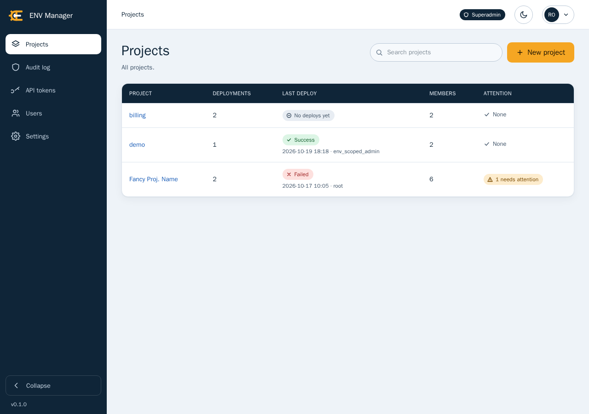

<p align="center">
  
</p>

# ENV Manager

A self-hosted web application for keeping the `.env` files, certificates and other text
configuration of your Docker Compose deployments in one place, versioned and encrypted, and for
putting them on the server safely.

Config files for many deployments usually live as loose files on servers: copied by hand,
edited in place, shared in chat, and nobody can tell who changed what or whether the file on disk
is still the one that was approved. ENV Manager stores each file once, encrypted, with its full
history, and deploys a chosen version to the host path where the deployment reads it. It refuses
to overwrite a file that someone changed behind its back, and it records everything in an audit
log. It is for small teams and operators who run Docker Compose on their own hosts and want
review, access control and traceability without adopting a full secrets platform.

It ships as a single Docker image (`websvcpt/env-manager`) with an embedded SQLite database. There
is no external database, queue or cache to run.

## Features

- **Versioned, encrypted config files.** Every save is a new version with author, comment and
  time. Values are encrypted at rest with a master key you keep outside the data volume, shown
  masked in the interface and revealed one at a time, with each reveal audited.
- **Deploys to host paths.** Write a version to the folder a deployment reads, with the mode,
  owner and group you set, atomically, and optionally run a post-deploy Docker command such as
  recreating the Compose service.
- **Drift protection.** If the file on disk changed outside the app, the deploy halts. A drift
  view compares the file on disk, the last deployed version and the managed version key by key,
  and lets you import the file or overwrite it deliberately.
- **Dist comparison.** Compare a file against its dist template (such as `.env.api-dist`) and block or
  warn on missing, extra or empty keys.
- **Audit log.** Every sign-in, reveal, change, deploy and setting change is recorded, filterable
  and exportable to CSV.
- **Roles and scoped access.** Superadmin, admin and viewer groups, with grants down to a single
  project, deployment, service or file, and an access grid that shows who can reach what.
- **API tokens.** Scoped bearer tokens let CI deploy a service or read its last deployment, and
  nothing else.
- **Backups.** Scheduled and manual online backups with retention, an optional extra destination
  and restore from the interface or the command line.
- **Git sync.** Optionally push an encrypted export to a private git repository for an off-host
  copy.
- **Notifications.** Email about sign-ins from new addresses, lockouts, failed deploys, backups
  and user changes, plus a signed webhook for every deploy result.
- **Accounts.** Two-factor sign-in, active session management, lockouts and a master key rotation
  command.

## Screenshots




## Quick start

You need Docker with the Compose plugin and a host folder that holds your deployments.

1. Create a folder and save this as `compose.yaml` in it (it is
   [`deploy/compose.yaml`](deploy/compose.yaml) with the published image):

   ```yaml
   services:
     envmanager:
       image: websvcpt/env-manager:latest
       restart: unless-stopped
       environment:
         ENVMANAGER_KEY_FILE: /run/keys/master.key
         ENVMANAGER_BASE_URL: http://localhost:8080
         # Peers whose X-Forwarded-For and X-Forwarded-Proto headers are believed (the reverse
         # proxy in front of the application):
         # ENVMANAGER_TRUSTED_PROXIES: 172.18.0.0/16
       volumes:
         - ./data:/data
         - ./master.key:/run/keys/master.key:ro
         - /var/www/vhosts:/var/www/vhosts
         - /opt:/opt
         # optional: enables post-deploy commands (root-equivalent on the host)
         # - /var/run/docker.sock:/var/run/docker.sock
       ports:
         - 127.0.0.1:8080:8080
   ```

   Change `ENVMANAGER_BASE_URL` to the address people will open. Behind a reverse proxy that ends
   https, use the `https://` address and set `ENVMANAGER_TRUSTED_PROXIES`. Mount the host folders
   that hold your deployments at the same path as on the host (the sample uses `/var/www/vhosts`
   and `/opt`).

2. Create the master key. Keep a copy in a password manager and never store it next to the data or
   the backups: without it nothing can be read.

   ```sh
   openssl rand -base64 32 > master.key
   chmod 600 master.key
   ```

3. Start the container:

   ```sh
   docker compose up -d
   ```

4. Create the first superadmin. The command prints a generated password once:

   ```sh
   docker compose exec envmanager envmanager user create \
     --email you@example.com --name "Your Name" --group superadmin
   ```

5. Open the address you set as the base URL (<http://localhost:8080> above) and sign in with that
   email and password. A banner says no path is allowed yet.

6. Open Settings, then Allowed paths, and add the folder that holds your deployments (for example
   `/opt`). Only folders on that list can be deployed to. Then create a project, a deployment, a
   service and an environment file, and deploy it.

The detailed guide, including file ownership, reverse proxies, backups and upgrades, is in
[docs/deployment.md](docs/deployment.md).

## Documentation

- [Deployment and network configuration](docs/deployment.md): the production setup, file ownership,
  the Docker socket, upgrades, trusted proxies and allowed sources.
- [Configuration and observability](docs/configuration.md): the Settings tabs, Sentry and
  OpenTelemetry.
- [Operations](docs/operations.md): backup and restore, key rotation, git sync, email
  notifications and the deploy webhook.
- [Using ENV Manager](docs/usage.md): deploying from the command line, the drift view, users,
  accounts and post-deploy commands.
- [API tokens and the API](docs/api.md): creating tokens and calling the deploy API.
- [Development](docs/development.md): the development stack, make targets, tests and the demo
  deployment.

## Development

Contributors work in a Docker based development stack driven by `make`. See
[docs/development.md](docs/development.md).

## License

ENV Manager is licensed under the Apache License 2.0, see [LICENSE](LICENSE).
