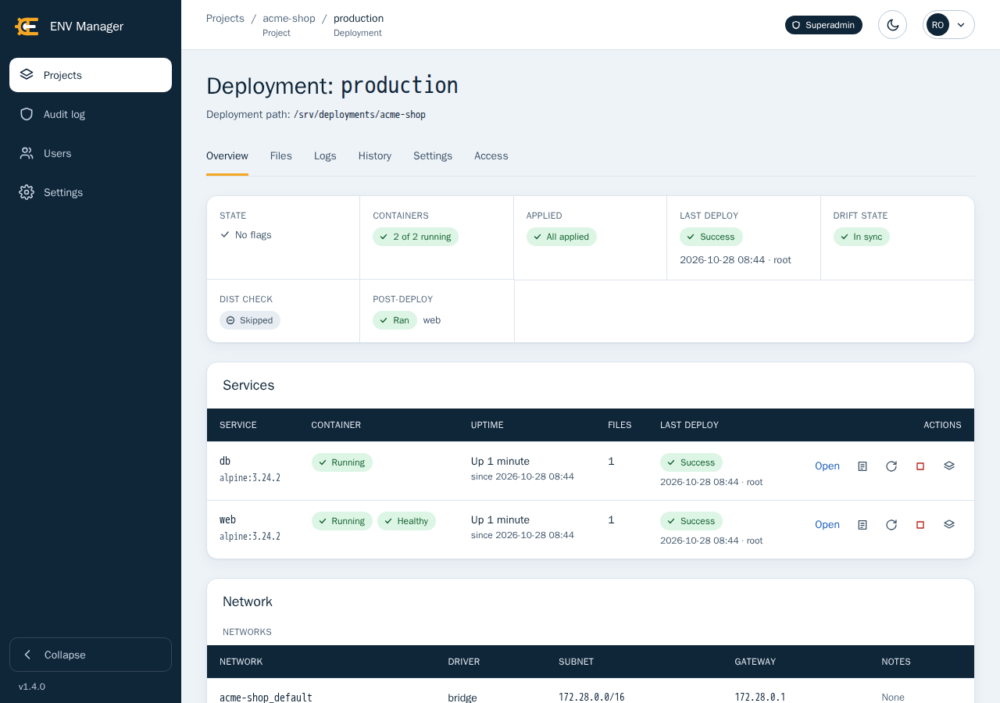
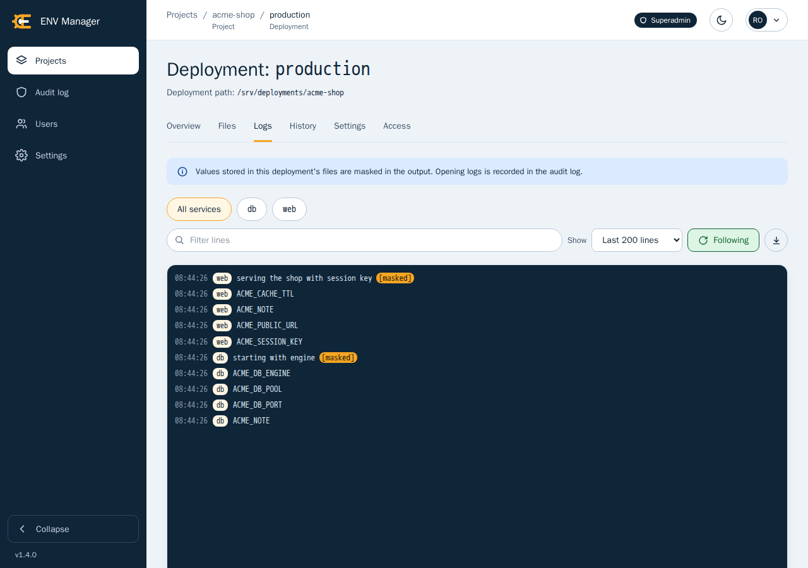
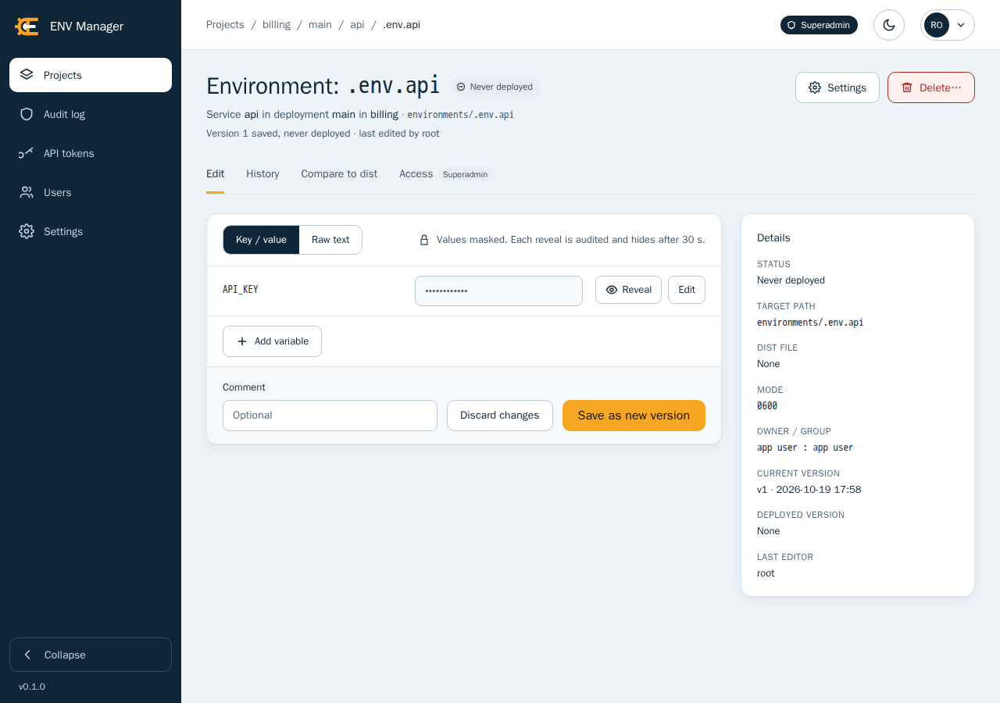
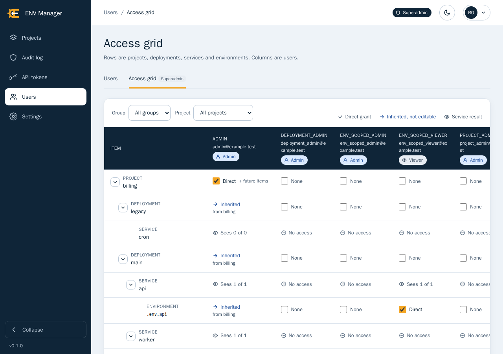
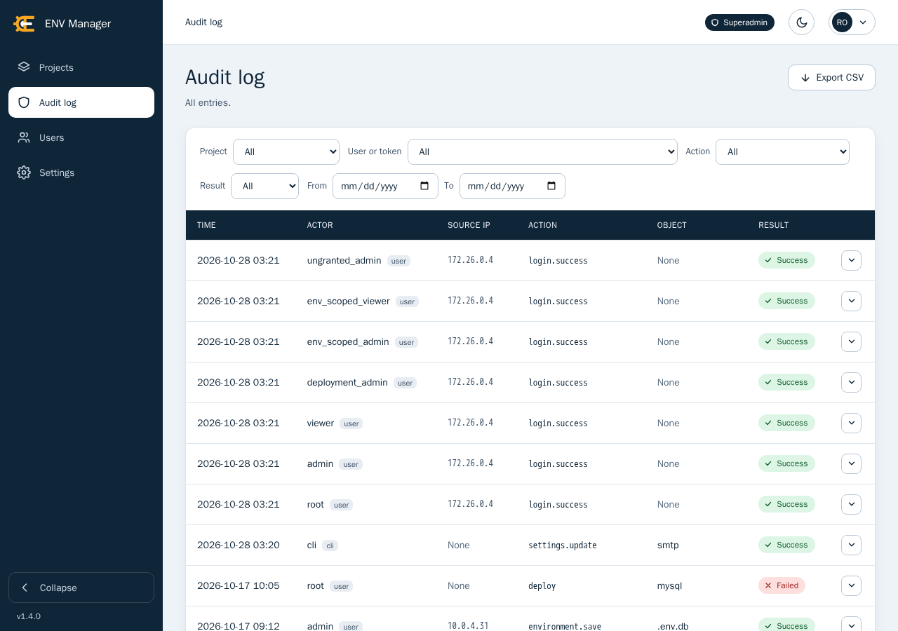

# ENV Manager

  

A self-hosted web application for keeping the `.env` files, certificates and other text
configuration of your Docker Compose deployments in one place, versioned and encrypted, and for
putting them on the server safely.

Config files for many deployments usually live as loose files on servers: copied by hand,
edited in place, shared in chat, and nobody can tell who changed what or whether the file on disk
is still the one that was approved. ENV Manager stores each file once, encrypted, with its full
history, and deploys a chosen version to the host path where the deployment reads it. It refuses
to overwrite a file that someone changed behind its back, and it records everything in an audit
log. It is for small teams and operators who run Docker Compose on their own hosts and want
review, access control and traceability without adopting a full secrets platform.

It ships as a single Docker image (`websvcpt/env-manager`) with an embedded SQLite database. There
is no external database, queue or cache to run.

There are other tools out there much more capable than this, but this tool solves a specific problem others might not support in full.   
It allows to manage environment files used on docker compose deployments without having to make changes to the deplpoyment itself.

It allows the import/adoption of existing deployments and to interact with them.   
When we define environment files as env file or as mount to a service, we are able to update these files from ENV-Manager.   
It does not allow to add ENV vars to a deployment - This is out of scope.   
The docker compose deployment should still handle the backup of it's configurations via git or other.   
ENV-Manager is able to backup only what it was managing regarding the deployment.

The day you want to bring ENV-Manager down, your deployment will continue to work as before, and you can still manage it manually.

**Buy me a coffee**

If you'd like to thank me, you can buy me a coffee. Coffee is never too much :)

https://www.buymeacoffee.com/websvc


## Features

**Config files**
- Versioned `.env` files and certificates: every save is a new version with author, comment and
  time, with history, diffs and restore.
- Encrypted at rest with a master key kept outside the data volume; values are shown masked and
  each reveal is audited.
- ENV files edited key by key, certificates as one PEM value.
- Dist comparison: check a file against its template (such as `.env.api-dist`) for missing, extra
  or empty keys, or create the file from it.
- Drift protection: a deploy halts when the file on disk was changed outside the app; compare it
  key by key, then import it or overwrite it deliberately.

**Deploys**
- Deploy a version to the host path the stack reads, atomically, with the mode, owner and group
  you set, after a dry-run pre-flight.
- Post-deploy Docker commands, such as recreating the Compose service, with private registry
  logins for private images.
- Import a deployment's services and files from its Docker Compose files; the Compose files stay
  linked read only.
- Scoped API tokens let CI deploy one service and nothing else.

**Docker stack**
- Create a deployment from a Compose stack found on the host.
- Overview of the running stack: container state, health, uptime and restarts, files waiting for
  a recreate, networks, addresses and published ports.
- Start, stop, restart or recreate a service, each behind a confirmation.
- Follow container logs, with the values of the deployment's own files masked.

**Access and security**
- Superadmin, admin and viewer groups with grants down to a single project, deployment, service or
  file, and an access grid that shows who reaches what.
- Single sign-on through OpenID Connect (Keycloak and other providers).
- Two-factor authentication, active sessions, lockouts and master key rotation.
- Audit log of every sign in, reveal, change, deploy and setting, filterable and exportable to
  CSV.

**Operations**
- One Docker image with an embedded SQLite database: no external database, queue or cache.
- Scheduled and manual backups with retention and restore, and an optional encrypted push to a
  private git repository.
- Email notifications and a signed webhook for every deploy result.

## Screenshots











## Quick start

You need Docker with the Compose plugin and a host folder that holds your deployments.

1. Create a folder for the installation and, inside it, the data folder:

   ```sh
   mkdir -p data/runtime
   ```

2. Create the master key as `data/master.key`:

   ```sh
   openssl rand -base64 32 > data/master.key
   chmod 600 data/master.key
   ```

   `data/master.key` sits beside `data/runtime`, the folder that holds the database and the
   backups, so a copy of the whole `data` folder carries the key too. Without the key nothing can
   be read, so back the key up on its own, in a password manager or secret store, and never keep
   it only next to a backup of `data/runtime`.

3. Save this as `docker-compose.yaml` in the folder (it is
   [`deploy/docker-compose.yaml`](deploy/docker-compose.yaml) with the published image):

   ```yaml
   services:
     envmanager:
       image: websvcpt/env-manager:latest
       restart: unless-stopped
       container_name: envmanager
       env_file: .env
       environment:
         ENVMANAGER_KEY_FILE: /run/keys/master.key
       volumes:
         - ./data/runtime:/data
         - ./data/master.key:/run/keys/master.key:ro
         # optional: mount the host's vhosts and opt folders to be able to read/write files on the host
         - /var/www/vhosts:/var/www/vhosts
         - /opt:/opt
         # optional: enables post-deploy commands, the stack overview, container actions and logs
         # (root-equivalent on the host)
         # - /var/run/docker.sock:/var/run/docker.sock
       ports:
         - 127.0.0.1:8080:8080
   ```

   Mount the host folders that hold your deployments at the same path as on the host (the sample
   uses `/var/www/vhosts` and `/opt`).

4. Copy [`deploy/.env.example`](deploy/.env.example) from the repository to `.env` next to it and
   adjust it.

   Set `ENVMANAGER_BASE_URL` to the address people will open (behind a reverse proxy that ends
   https, use the `https://` address and set `ENVMANAGER_TRUSTED_PROXIES`) and give
   `ENVMANAGER_CSRF_SECRET` a secret of at least 32 characters, for example the output of
   `openssl rand -hex 32`. Every setting is described in
   [Environment variables](#environment-variables).

5. Start the container:

   ```sh
   docker compose up -d
   ```

6. Create the first superadmin. The command prints a generated password once:

   ```sh
   docker compose exec envmanager envmanager user create \
     --email you@example.com --name "Your Name" --group superadmin
   ```

7. Open the address you set as the base URL and sign in with that email and password. A banner
   says no path is allowed yet.

8. Open Settings, then Allowed paths, and add the folder that holds your deployments (for example
   `/opt`). Only folders on that list can be deployed to. Then create a project, a deployment, a
   service and an environment file, and deploy it.

The detailed guide, including file ownership, reverse proxies, backups and upgrades, is in
[docs/deployment.md](docs/deployment.md).

## Environment variables

The application reads its startup configuration from `ENVMANAGER_` environment variables only,
checks every value when it starts and stops with a message that names the variable when one is
invalid. The production setup keeps them in `.env` (see
[`deploy/.env.example`](deploy/.env.example)). Settings marked "development and testing only" are
refused when `ENVMANAGER_ENVIRONMENT` is anything else. Lists are comma separated.

| Variable | Default | Purpose |
| --- | --- | --- |
| `ENVMANAGER_BASE_URL` | `http://localhost:8080` | The address people open, used in links the application sends. When it starts with `https://` the session and CSRF cookies are sent with the `Secure` flag. Outside development and testing a value that does not start with `https://` logs a warning at startup. |
| `ENVMANAGER_CSRF_SECRET` | unset | Secret that signs the CSRF tokens. Required, at least 32 characters: startup is refused without it. Only the `testing` environment may leave it out. |
| `ENVMANAGER_KEY_FILE` | unset | Path, inside the container, of a file that holds the master key (the sample mounts `data/master.key` at `/run/keys/master.key`). The file is read as ASCII text and an unreadable file stops startup. Set exactly one of `ENVMANAGER_KEY_FILE` and `ENVMANAGER_KEY`. |
| `ENVMANAGER_KEY` | unset | The master key itself: base64 text that decodes to exactly 32 bytes. An empty value counts as unset. Setting it together with `ENVMANAGER_KEY_FILE` is refused so a stale value cannot shadow the mounted key, and having neither stops startup. Prefer the key file. |
| `ENVMANAGER_TRUSTED_PROXIES` | empty (no proxy is trusted) | IPv4 and IPv6 addresses or CIDR networks of the reverse proxies whose `X-Forwarded-For` and `X-Forwarded-Proto` headers are believed, for example `172.18.0.2,fd00::/8`. `*` and networks that hold every address (`0.0.0.0/0`, `::/0`) are refused, and so is a network with host bits set. See [Network configuration](docs/deployment.md#network-configuration). |
| `ENVMANAGER_ALLOWED_SOURCES` | empty (everyone) | IPv4 and IPv6 addresses or CIDR networks that may use the application at all, for example `203.0.113.0/24,2001:db8::/32`. Every other client gets a `403`. `0.0.0.0/0` and `::/0` are accepted. See [Network configuration](docs/deployment.md#network-configuration). |
| `ENVMANAGER_CORS_ORIGINS` | empty (same origin only) | Origins that may call the `/api/` prefix from a browser, for example `https://ci.example.com`. Each must start with `http://` or `https://`; `*` is refused. Credentials are never allowed. |
| `ENVMANAGER_SENTRY_DSN` | unset (error reporting off) | Turns error reporting to Sentry on, without personal data. See [Configuration and observability](docs/configuration.md#observability-and-error-reporting). |
| `ENVMANAGER_LOG_LEVEL` | `INFO` | One of `CRITICAL`, `ERROR`, `WARNING`, `INFO` or `DEBUG`, in any case. Anything else is refused. |
| `ENVMANAGER_PORT` | `8080` | Port the server listens on inside the container. The image health check reads it too. If you change it, change the published port in `docker-compose.yaml`. |
| `ENVMANAGER_DATA_PATH` | `/data` (the image sets it) | Folder that holds the database, the backups, the lock files and the git sync clone. Mount the data volume there. |
| `ENVMANAGER_DOCKER_SOCKET` | `/var/run/docker.sock` | Path, inside the container, of the Docker socket that post-deploy commands, the stack overview, the container actions and the logs use. Change it only if the socket is mounted somewhere else. |
| `ENVMANAGER_ENVIRONMENT` | `production` | Name of the deployment environment, also reported to Sentry and OpenTelemetry. The values `development` and `testing` switch on the development and testing only settings and skip the `https` warning; `testing` also skips the CSRF secret requirement. Keep `production` on a real server. |
| `ENVMANAGER_TITLE` | `ENV Manager` | Title of the API documentation. Only visible where `ENVMANAGER_SERVE_DOCS` is on. |
| `ENVMANAGER_DESCRIPTION` | `A self-hosted web application for keeping the .env files, certificates and other text configuration of your Docker Compose deployments in one place, versioned and encrypted, and for putting them on the server safely.` | Description of the API documentation. Only visible where `ENVMANAGER_SERVE_DOCS` is on. |
| `ENVMANAGER_SERVE_DOCS` | `false` | Development and testing only. Serves the API documentation at `/docs`, `/redoc` and `/openapi.json` without sign-in. Refused in any other environment. |
| `ENVMANAGER_LOGIN_IP_MAX_FAILURES` | unset (20 failed sign ins in 15 minutes unless Settings changes it) | Development and testing only. A number from 1 to 100000 that replaces the limit of failed sign ins per client address and wins over the stored value. Refused in any other environment. |
| `ENVMANAGER_DEMO_ROOT` | unset | Development and testing only. Absolute path below which `envmanager dev seed` also creates the demo project. Empty counts as unset, a relative path is refused. |

The start script of the image also reads `ENVMANAGER_HOST` (the address the server binds to,
`0.0.0.0` unless set). OpenTelemetry has its own standard variables, described in
[Configuration and observability](docs/configuration.md).

The development stack (`make` and `docker-compose.yml`, not the application) also reads
`DEV_HOST`, default `localhost`: the address of the machine that both a browser and the app
container reach, which builds the issuer of the development Keycloak and the development
`ENVMANAGER_BASE_URL`. See [Development](docs/development.md#single-sign-on-in-development).

## Documentation

- [Deployment and network configuration](docs/deployment.md): the production setup, file ownership,
  the Docker socket, upgrades, trusted proxies and allowed sources.
- [Configuration and observability](docs/configuration.md): the Settings tabs, setting up Keycloak
  for single sign-on, Sentry and OpenTelemetry.
- [Operations](docs/operations.md): backup and restore, key rotation, Docker access (what each feature
  runs through the socket), the Docker scratch folder,
  git sync, email notifications and the deploy webhook.
- [Using ENV Manager](docs/usage.md): creating a deployment from a detected stack, the Overview,
  container actions and logs of a running stack, deploying from the command line, the drift view, users,
  accounts and post-deploy commands.
- [API tokens and the API](docs/api.md): creating tokens and calling the deploy API.
- [Development](docs/development.md): the development stack, make targets, tests, the demo
  deployment and the development Keycloak.

## Development

Contributors work in a Docker based development stack driven by `make`. See
[docs/development.md](docs/development.md), and read [CONTRIBUTING.md](CONTRIBUTING.md) before
opening a pull request.

## License

ENV Manager is licensed under the Apache License 2.0, see [LICENSE](LICENSE).
